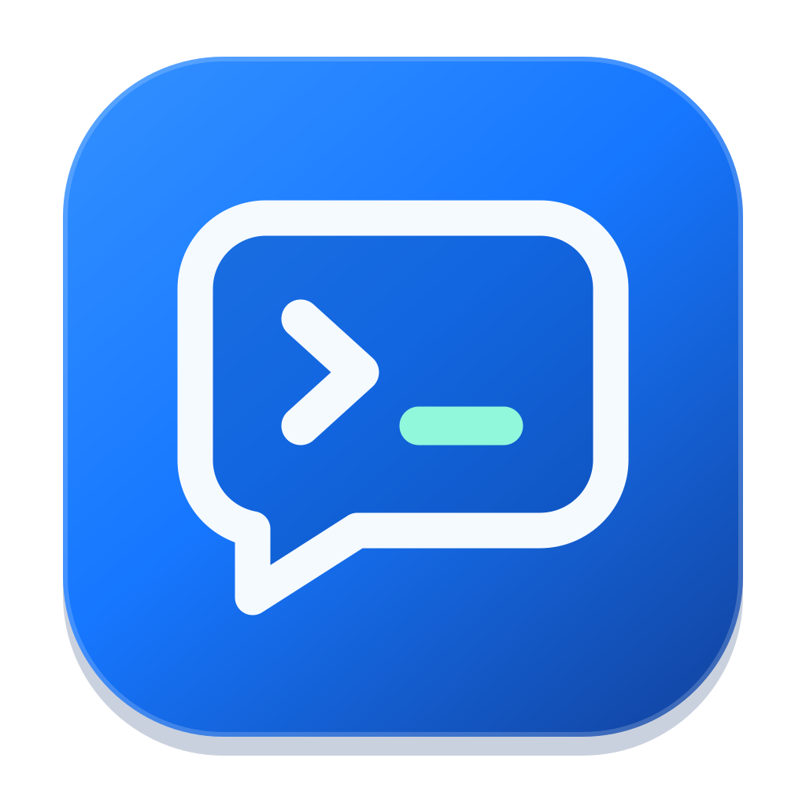
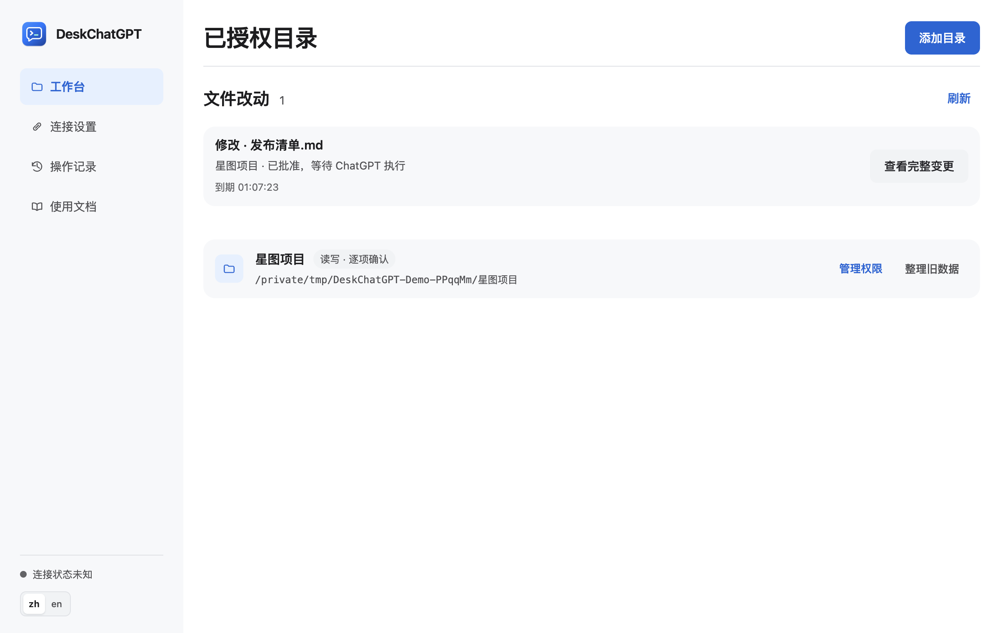
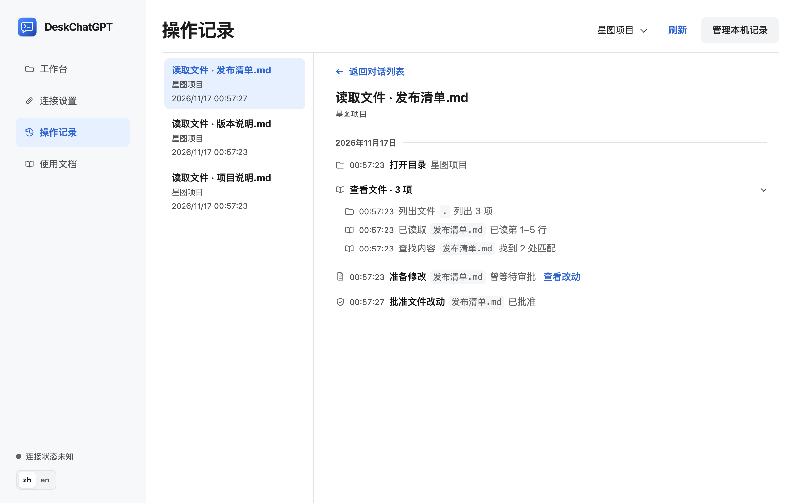

# DeskChatGPT

DeskChatGPT is a tool for running local tasks on your Mac from ChatGPT. You converse in Chat or Dot, and DeskChatGPT carries out authorized tasks on the Mac you choose, including reading and writing files, running commands, and interacting with webpages and the desktop.

[Features](#features) · [Download](#download) · [Usage](#usage) · [Multiple Macs](#multiple-macs) · [EULA](EULA.md#english) · [Support](#support)

| Workbench | Activity |
| :---: | :---: |
|  |  |

## Features

- **Chat and Dot:** Set up DeskChatGPT in your ChatGPT workspace and use its authorized local tools in either mode.
- **Files and projects:** Browse folders, search and read files, create, edit, move, delete, and perform batch changes with review and supported recovery.
- **Terminal and Git:** Run commands, builds, and tests, inspect task output and status, and stop running tasks. Protected execution is the default. Native execution for tools such as SwiftPM and Xcode requires confirmation on your Mac.
- **Isolated browser:** Open and inspect websites, interact with pages, fill forms, and capture screenshots.
- **Desktop control:** List and open apps, capture screens, and interact with windows using macOS permissions.
- **Flexible permissions:** Choose read-only, per-change approval, or direct read/write for folders. Grant Terminal, browser, and desktop access separately.
- **Activity history:** Review task states, file changes, and execution receipts.

## Download

The macOS installers require macOS 26 or later. [v0.4.6 release notes and SHA-256 checksums](https://github.com/jiangxinlei/DeskChatGPT/releases/tag/v0.4.6)

| Platform | Architecture          | Package | Progress                                                                 |
| -------- | --------------------- | ------- | ------------------------------------------------------------------------ |
| macOS    | Apple Silicon (arm64) | [DMG](https://github.com/jiangxinlei/DeskChatGPT/releases/download/v0.4.6/DeskChatGPT-0.4.6-macos-arm64.dmg) | Published |
| macOS    | Intel (x64)           | [DMG](https://github.com/jiangxinlei/DeskChatGPT/releases/download/v0.4.6/DeskChatGPT-0.4.6-macos-x64.dmg) | Published. Testing on an Intel Mac is pending. |
| Windows  | x64                   | EXE     | Native implementation and installer in development; not downloadable yet |

## Usage

1. Create a private Tunnel on OpenAI Platform and connect this Mac in DeskChatGPT.
2. Add the corresponding custom MCP tool to your ChatGPT workspace.
3. Grant the folders you need in Workbench. Start with **read-only** access.
4. In Chat, use `@` to select DeskChatGPT. In Dot, use the DeskChatGPT tool configured in your workspace. Start by reading a file in an authorized folder.

See [Getting started](docs/en/start.md) for step-by-step instructions.

## Multiple Macs

Connect your home and office Macs to the same ChatGPT workspace and choose which one runs each task.

1. Install DeskChatGPT on each Mac and connect each installation to its own Tunnel.
2. Add a custom MCP tool for each Tunnel ID in the same ChatGPT workspace. Give the tools distinct names, such as `DeskChatGPT-Home` and `DeskChatGPT-Office`.
3. To read a file on your home Mac, select `@DeskChatGPT-Home` in Chat or use the tool with that name in Dot. The Mac must be online with access to the folder already granted.

Manage folder access and approve operations on the target Mac. Each Mac keeps its own files, runtime key, and permissions.

## Documentation

[Getting started](docs/en/start.md) · [Permissions and security](docs/en/safety.md) · [Data and privacy](docs/en/privacy.md) · [FAQ](docs/en/faq.md)

> Terminal and Git run under your OS user. Tool results may return to ChatGPT. See [Security](SECURITY.md) for permission boundaries and limitations.

## Support

For bugs and feature requests, visit [GitHub Issues](https://github.com/jiangxinlei/DeskChatGPT/issues). If the project helps you, consider starring the repository.

---

DeskChatGPT is independently developed and is not affiliated with or endorsed by OpenAI.
