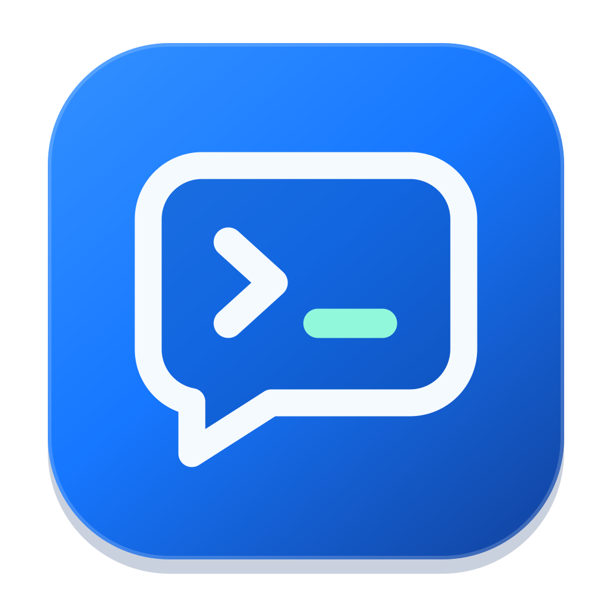

# DeskChatGPT

在 ChatGPT 里读写 Mac 文件、运行命令和操作桌面，权限由你掌控。

[功能特点](#功能特点) · [下载](#下载) · [使用](#使用) · [多台 Mac](#多台-mac) · [交流与支持](#交流与支持)

| 工作台 | 操作记录 |
| :---: | :---: |
|  |  |

## 功能特点

- **支持 Chat 和 Dot**：在 ChatGPT 工作区配置 DeskChatGPT 后，可在 Chat 和 Dot 模式使用已授权的本机工具。
- **文件与项目**：浏览目录、搜索文件、读取内容；创建、修改、移动、删除文件，支持批量改动、差异确认及适用的恢复操作。
- **终端与 Git**：执行命令、构建和测试，查看任务输出与运行状态，按需停止任务。
- **独立浏览器**：打开和阅读网页，点击、填写表单及截图。
- **桌面控制**：查看和打开应用，截图、操作鼠标与键盘，需获得 macOS 系统授权。
- **灵活的权限管理**：目录支持只读、逐项确认和直接读写；终端、浏览器与桌面能力分别授权。
- **操作记录**：查看任务状态、文件变更和执行回执，方便核对结果和排查问题。

## 下载

macOS 安装包已在 [v0.4.3 发布页](https://github.com/jiangxinlei/DeskChatGPT/releases/tag/v0.4.3) 提供，适用于 macOS 26 及以上版本。

| 系统    | 架构                   | 安装包 | 当前进度                                   |
| ------- | ---------------------- | ------ | ------------------------------------------ |
| macOS   | Apple Silicon（arm64） | [DMG](https://github.com/jiangxinlei/DeskChatGPT/releases/download/v0.4.3/DeskChatGPT-0.4.3-macos-arm64.dmg) | 已发布，已在 Apple 芯片 Mac 上验证启动和 Tunnel 连接 |
| macOS   | Intel（x64）           | [DMG](https://github.com/jiangxinlei/DeskChatGPT/releases/download/v0.4.3/DeskChatGPT-0.4.3-macos-x64.dmg) | 已发布，已通过 Rosetta 桌面回归，Intel 实机待验证 |
| Windows | x64                    | EXE    | 原生适配与安装包开发中，暂不提供下载       |

## 使用

1. 在 OpenAI Platform 创建私有 Tunnel，并在 DeskChatGPT 中连接当前 Mac。
2. 在 ChatGPT 工作区添加对应的自定义 MCP 工具。
3. 在 DeskChatGPT「工作台」授权需要访问的目录，建议先选择**只读**。
4. 在 Chat 模式用 `@` 选择 DeskChatGPT，在 Dot 模式使用工作区已配置的 DeskChatGPT 工具。首次可试着读取一个已授权的文件。

详细步骤见 [快速上手](docs/zh/start.md)。

## 多台 Mac

你可以在同一个 ChatGPT 工作区连接家里的 Mac 和公司的 Mac，并为每次任务选择目标电脑。

1. 在每台 Mac 上分别安装 DeskChatGPT，各自连接一个独立的 Tunnel。
2. 在同一个 ChatGPT 工作区添加两个自定义 MCP 工具，填入各自的 Tunnel ID，例如命名为 `DeskChatGPT-家里` 和 `DeskChatGPT-公司`。
3. 要读取家里电脑的文件，就在 Chat 中选择 `@DeskChatGPT-家里`，或在 Dot 中使用同名工具。目标 Mac 需要在线，并已授权要访问的目录。

目录授权和操作审批在对应的 Mac 上管理。文件、运行密钥和权限各自保存在对应电脑上。

## 使用文档

[快速上手](docs/zh/start.md) · [授权与安全](docs/zh/safety.md) · [数据与隐私](docs/zh/privacy.md) · [常见问题](docs/zh/faq.md)

> 终端与 Git 使用当前系统用户权限，工具结果可能返回 ChatGPT。详细权限与限制见 [安全说明](SECURITY.md)。

## 交流与支持

问题与建议：[GitHub Issues](https://github.com/jiangxinlei/DeskChatGPT/issues)。欢迎为项目点一个 Star。

### 加群交流

### 请作者喝杯咖啡

如果 DeskChatGPT 帮到了你，欢迎请作者喝杯咖啡。

